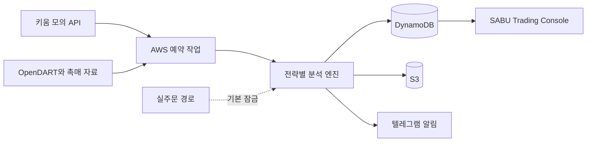

# SABU Trading Console

키움증권 REST API와 AWS를 이용해 한국 주식의 종가배팅, 중기, 장중 단타 전략을
분석하고 모의운용하기 위한 자동매매 프로젝트입니다. 현재 운영 기준은 **모의투자
우선**이며, 실거래는 안전장치와 실제 환경 통합검증이 끝날 때까지 잠겨 있습니다.

> **현재 안전 상태**  
> 실거래 비활성화 · 비상정지 기본 ON · 실제 주문 없음 · 기존 계좌 보유종목 보호

## 현재 단계

| 구분 | 상태 | 설명 |
|---|---|---|
| 종가배팅 | 구현 · PC-C 통합검증 대기 | KRX 15:20 모의진입, 다음 거래일 09:10 기본 청산 |
| 중기전략 | 구현 · PC-C 통합검증 대기 | 수 주에서 1~2개월 보유, 별도 자금과 원장 사용 |
| 장중 단타 | 단발 모의 스캔 구현 | 사용자 요청 시 `DAY_TRADE_ON_DEMAND`를 한 번 실행 |
| 연속 단타 | 설계만 완료 | 09:00~15:30 연속 감시는 아직 구현·배포하지 않음 |
| 모바일 대시보드 | 읽기 전용 UI 구현 | 외부 접속용 Cognito와 HTTPS 배포는 미완료 |
| 실거래 | 잠금 | 별도 사용자 승인과 안전성 검증 전에는 활성화하지 않음 |

마지막 문서 기준 로컬 단위 테스트는 **140개 통과**입니다. Docker, 키움 모의 API,
DynamoDB, S3, CloudWatch와 AWS 배포는 PC-C에서 실제 통합검증해야 합니다.

## 주요 기능

- 거래대금, 거래량, 종가 강도, 일봉, 5분봉, VWAP, RSI, ATR 기반 후보 평가
- 검증된 당일 촉매 필수 조건과 시장 급락 시 `NO_TRADE`
- KRX 종가배팅 대상에서 NXT 거래 가능 종목 강제 제외
- 종가배팅, 중기, 단타의 자금·포지션·점수·성과 원장 완전 분리
- `IMMEDIATE`와 `5M_CONFIRMED` 손절, 별도 비상 하드 스톱
- DynamoDB 원자적 지갑 차감과 중복 판단 방지
- S3 원본 스냅샷과 결정 이력 보관
- 매매 결정 이유, 열린 포지션, 총자산 추이를 표시하는 모바일 대응 대시보드
- 계좌 지문, 보호 기준선과 프로그램 체결수량을 이용한 기존 보유종목 보호 골격
- 주문 승인, 부분체결, 취소, 대사와 불확실 상태의 자동 비상정지 골격

## 구성



현재 AWS 기본 구조는 짧게 실행되는 예약 작업을 사용합니다. 연속 단타는 이 구조를
반복 호출하지 않고, 향후 별도의 장중 세션과 고정 IP를 갖춘 EC2 방식으로 구현하도록
설계되어 있습니다.

## 빠른 시작

### Windows PowerShell

```powershell
Set-Location C:\Test\stock-automation
$env:PYTHONPATH = "src"
python -m unittest discover -s tests -v
python -m compileall -q src tests
python -m stock_automation.cli dashboard --fixture examples/dashboard_fixture.json
```

브라우저에서 `http://127.0.0.1:8765`를 엽니다. 샘플 화면은 읽기 전용이며 주문을
제출하지 않습니다.

### Docker

```powershell
Set-Location C:\Test
docker build -f stock-automation\Dockerfile -t stock-automation:dev .
```

Docker 빌드 컨텍스트는 저장소 루트이고, `stock-automation`과
`Kiwoom-REST-API`는 형제 폴더여야 합니다.

## PC별 역할

| 환경 | 경로 | 역할 |
|---|---|---|
| PC-D | `D:/Test` | 코드, 설계, 리뷰, 문서와 인수인계 |
| PC-C | `C:/Test` | Docker, 키움 모의, DynamoDB와 AWS 통합검증 |

PC-C에서는 코드를 받은 뒤 세 기준 문서와 실제 Git 상태를 확인하고, 전체 테스트부터
수행해야 합니다. 비밀키, 토큰, 계좌번호와 AWS 자격증명은 코드·문서·Git·로그에
기록하지 않습니다.

## 안전 원칙

- `LIVE_ORDER_ENABLED=1`을 별도 승인 없이 설정하지 않습니다.
- 비상정지를 해제하거나 실제 계좌 Secret을 연결하지 않습니다.
- 실제 주문과 AWS 실거래 예약을 자동으로 활성화하지 않습니다.
- 기존 계좌 보유종목은 프로그램 소유 수량으로 확인되지 않으면 매도하지 않습니다.
- 데이터 지연, API 오류, 계좌·수량 불일치와 불명확한 주문 상태에서는 안전 중지합니다.
- 종가배팅, 중기, 단타, 모의와 실거래 기록을 서로 섞지 않습니다.

## 주요 문서

- [자동매매 엔진 상세 설명](stock-automation/README.md)
- [PC-C 단독 진행 전체 인수인계](PC-C_%EB%8B%A8%EB%8F%85%EC%A7%84%ED%96%89_%EC%A0%84%EC%B2%B4%EC%9D%B8%EC%88%98%EC%9D%B8%EA%B3%84.md)
- [AWS 자동매매 실행 가이드](AWS_%EC%9E%90%EB%8F%99%EB%A7%A4%EB%A7%A4_%EC%8B%A4%ED%96%89%EA%B0%80%EC%9D%B4%EB%93%9C.md)
- [세션 간 공동 인수인계](Codex_%EC%84%B8%EC%85%98%EA%B0%84_%EA%B3%B5%EB%8F%99_%EC%9D%B8%EC%88%98%EC%9D%B8%EA%B3%84.md)
- [AWS 프로그램 아키텍처](docs/%ED%94%84%EB%A1%9C%EA%B7%B8%EB%9E%A8%20%EC%84%A4%EA%B3%84/AWS_%ED%94%84%EB%A1%9C%EA%B7%B8%EB%9E%A8_%EC%95%84%ED%82%A4%ED%85%8D%EC%B2%98.md)
- [연속 단타 AWS 운영설계와 예상비용](docs/%ED%94%84%EB%A1%9C%EA%B7%B8%EB%9E%A8%20%EC%84%A4%EA%B3%84/%EC%97%B0%EC%86%8D_%EB%8B%A8%ED%83%80_AWS_%EC%9A%B4%EC%98%81%EC%84%A4%EA%B3%84_%EB%B0%8F_%EC%98%88%EC%83%81%EB%B9%84%EC%9A%A9.md)

## 유의사항

이 프로젝트의 분석과 모의매매 결과는 수익을 보장하지 않습니다. 실제 투자 판단과
손실 책임은 사용자에게 있으며, 충분한 모의운용과 장애·손실 시나리오 검증 없이
실거래로 전환하지 않습니다.
