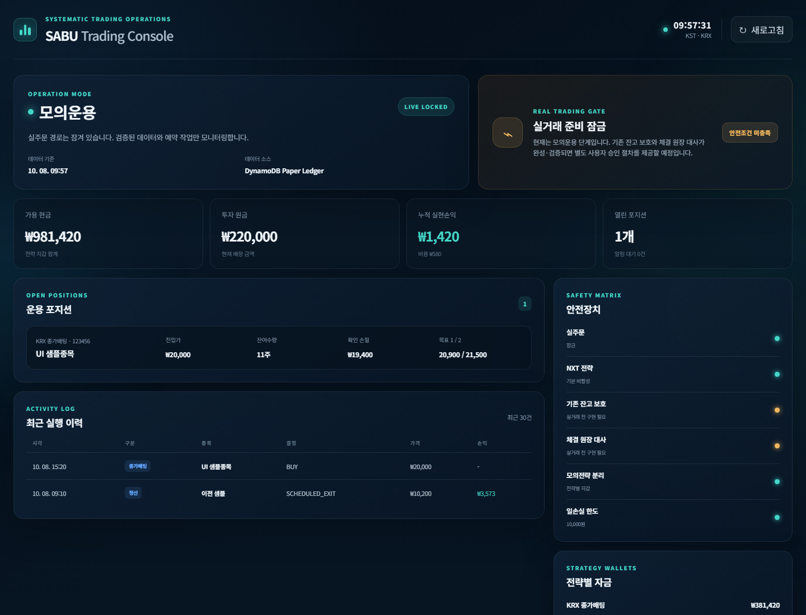
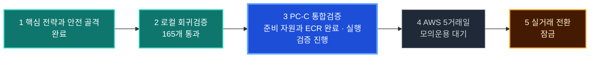
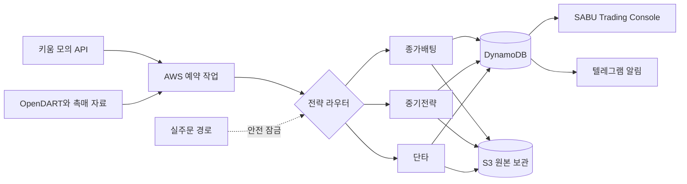
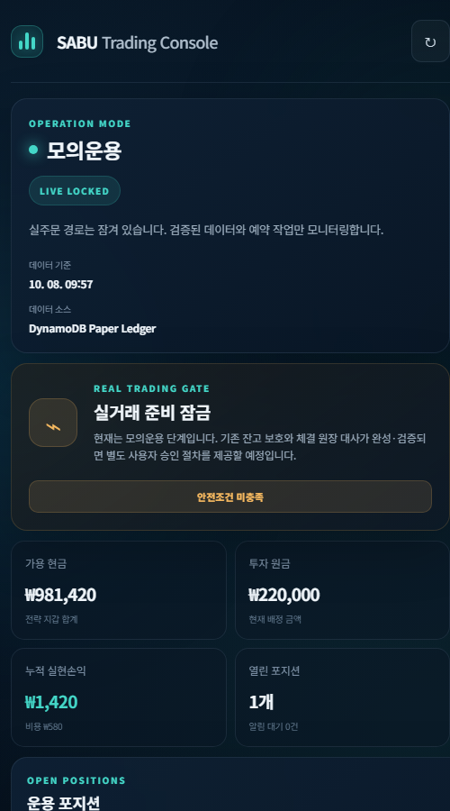

<div align="center">

# SABU Trading Console

### 키움증권과 AWS를 이용한 안전 우선 한국 주식 자동매매 시스템

종가배팅·중기·장중 단타를 서로 분리해 분석하고 기록하는 **모의운용 우선** 프로젝트입니다.  
수익 극대화보다 잘못된 주문과 큰 손실을 막는 것을 먼저 설계합니다.

[](stock-automation/tests)


</div>



> [!IMPORTANT]
> 현재 운영 기준은 키움 **모의투자**입니다. 실거래는 비활성화되어 있고 비상정지는
> 기본 ON입니다. 실제 주문, 실계좌 Secret 연결, AWS 실거래 예약은 별도 승인과
> 통합검증 없이는 활성화하지 않습니다.

## 한눈에 보는 현재 상태

확인 기준: **2026-10-14 KST**. 아래 배포 상태는 공동 인수인계에 기록된 PC-C 결과를
기준으로 하며, 현재 PC-D에서 AWS 상태를 실시간 조회한 결과는 아닙니다.

| 전략과 기능 | 현재 상태 | 다음 확인 |
|---|---|---|
| KRX 종가배팅 | 엔진 구현 완료 | PC-C 키움 모의·AWS 통합검증 |
| 1~2개월 중기전략 | 엔진 구현 완료 | 실제 모의 데이터 검증 |
| 장중 단타 | 요청 시 단발 모의 스캔 | S3·DynamoDB·대시보드 연결검증 |
| 연속 단타 | 운영설계와 비용산정 완료 | 사용자 승인 후 별도 구현 |
| PC·모바일 대시보드 | 읽기 전용 UI 구현 완료 | Cognito·HTTPS 외부 배포 |
| AWS 모의 준비 | Secret·네트워크·ECR 이미지 준비 기록 있음 | 키움 허용 IP 구조 확정·프로그램 스택 배포 |
| 컨테이너 보안 | 격리 설정과 회귀 테스트 추가 | PC-C 재빌드·재스캔·Fargate 실행검증 |
| 실거래 | 안전 잠금 | 모든 안전 관문 완료 후 별도 승인 |

> [!WARNING]
> 2026-10-14 검토 자료에는 **미해결 고유 CVE 69개(High 14개)**가 남아 있습니다.
> 비루트·읽기 전용 파일시스템·권한 제거는 노출을 줄이는 조치이며 취약점 패치 완료를
> 뜻하지 않습니다. 모의 통합검증도 [보안 검토의 재검증 조건](docs/%EC%9A%B4%EC%98%81%20%EA%B2%80%EC%A6%9D/2026-10-14_Docker_%EC%B7%A8%EC%95%BD%EC%A0%90_PC-D_%EA%B2%80%ED%86%A0.md)을 따라 진행합니다.

## 프로젝트 진행도

진행률은 단순 코드량이 아니라 **실거래 전 반드시 통과해야 하는 5개 안전 관문**으로
표시합니다. 현재는 핵심 구현·로컬 검증 2개 관문 완료, PC-C 통합검증 단계입니다.
이는 개발 관문의 진행 상태이며 운영 준비율이나 실거래 안전성의 백분율이 아닙니다.



| 안전 관문 | 상태 | 완료 기준 |
|---|---|---|
| 핵심 구현 | **완료** | 전략 분리, 위험관리, 원장, 대시보드와 주문 안전 골격 |
| 로컬 검증 | **완료** | PC-D 단위 테스트 165개와 `compileall` 통과 |
| PC-C 통합검증 | **진행 단계** | 165개 재현, 보안 설정 반영, 이미지 재스캔, 키움 모의 읽기·AWS 저장 확인 |
| AWS 모의운용 | **대기** | 예약 실행과 5거래일 이상 무사고 모의운용 |
| 실거래 | **잠금** | 계좌 보호·체결 대사·장애 복구 검증과 사용자 별도 승인 |

Docker 이미지 빌드와 ECR 업로드는 PC-C에서 이전 이미지로 검증했습니다. 이번 격리
설정은 아직 Fargate에 적용·실행하지 않았고, 프로그램 스택과 모의예약도 미배포·비활성
상태로 인수인계되어 있습니다. 전체 테스트 통과와 AWS 통합검증 완료를 구분합니다.

## 세 가지 독립 전략

| 전략 | 판단 시점 | 기본 보유기간 | 핵심 원칙 |
|---|---|---|---|
| **종가배팅** | KRX 15:20 | 다음 거래일 09:10까지 | NXT 종목 제외, 약한 시장에서는 `NO_TRADE` |
| **중기전략** | 장 마감 신호 후 다음 날 확인 | 20~40거래일 | 공시·재무 위험 확인, 종가를 체결가로 소급하지 않음 |
| **장중 단타** | 요청 시 09:10~14:50 | 당일 15:10까지 | 단발 모의 스캔, 연속 감시와 실주문은 미연결 |

세 전략은 자금, 점수, 포지션, 손절, 성과와 원장을 공유하지 않습니다. 추천할 만한
종목이 없을 때는 거래하지 않는 것이 정상 결과입니다.

## 시스템 구조

아래는 목표 연결 구조입니다. ECR 이미지 준비 이후 프로그램 스택 배포와 실제 API·저장소
연결검증이 남아 있습니다.



현재 AWS 구조는 정해진 시간에 짧게 실행되는 작업을 기본으로 합니다. 장중 연속 단타는
작업을 반복 호출하는 방식이 아니라 별도의 장중 세션과 고정 IP가 필요하므로 아직
실행 코드와 인프라를 배포하지 않았습니다.

## 핵심 안전장치

- `LIVE_ORDER_ENABLED` 기본 비활성화와 비상정지 기본 ON
- NXT 가능 종목의 KRX 종가배팅 강제 제외
- 데이터 지연, API 오류와 세션 불일치 시 안전 종료
- `IMMEDIATE`와 `5M_CONFIRMED` 손절, 별도 비상 하드 스톱
- DynamoDB 원자적 지갑 차감과 동일 결정 중복 실행 방지
- 계좌 지문과 최초 보유수량 기준선을 이용한 기존 보유종목 보호
- 프로그램의 확인된 실제 체결수량까지만 매도 허용
- 부분체결·취소·거부·불명확 상태 분리와 잔고 불일치 시 비상정지
- 모의·실거래 및 종가배팅·중기·단타의 자금과 성과 완전 분리

## 대시보드

`SABU Trading Console`은 주문 화면이 아니라 **읽기 전용 운영 화면**입니다. 가용현금,
투자원금, 누적손익, 열린 포지션, 판단 이유, 전략별 지갑, 일별 총자산 추이와 안전장치
상태를 PC와 모바일에서 확인할 수 있습니다.

<details>
<summary><strong>모바일 화면 보기</strong></summary>

<p align="center">
  
</p>

</details>

## 로컬에서 화면 실행

<details>
<summary><strong>Windows PowerShell 실행 명령 보기</strong></summary>

```powershell
Set-Location C:\Test\stock-automation
$env:PYTHONPATH = "src"
python -m unittest discover -s tests -v
python -m compileall -q src tests
python -m stock_automation.cli dashboard --fixture examples/dashboard_fixture.json
```

브라우저에서 `http://127.0.0.1:8765`를 엽니다. 샘플 데이터 화면은 읽기 전용이며
주문을 제출하지 않습니다.

</details>

<details>
<summary><strong>Docker 빌드 명령 보기</strong></summary>

```powershell
Set-Location C:\Test
docker build -f stock-automation\Dockerfile -t stock-automation:dev .
```

Docker 빌드 컨텍스트는 저장소 루트입니다. `stock-automation`과
`Kiwoom-REST-API`는 형제 폴더로 유지합니다.

</details>

## PC별 작업 구분

| 환경 | 기본 경로 | 역할 |
|---|---|---|
| PC-D | `D:/Test` | 코드, 설계, 리뷰, 문서와 인수인계 |
| PC-C | `C:/Test` | Docker, 키움 모의, DynamoDB와 AWS 통합검증 |

PC-C는 pull 후 `AGENTS.md`, PC-C 전체 인수인계, 공동 인수인계와 실제 코드를 비교하고
전체 테스트부터 다시 수행합니다. 비밀키, 토큰, 계좌번호와 AWS 자격증명은 코드,
Markdown, Git과 일반 로그에 기록하지 않습니다.

## 다음 작업

- [x] PC-C 모의용 Secret·네트워크와 ECR 이미지 준비 기록 확인
- [x] PC-D 취약점 영향 검토와 컨테이너 격리 설정 추가
- [x] PC-D 전체 테스트 165개와 Python 구문검사 통과
- [ ] PC-C에서 pull 후 세 인수인계 파일 확인과 전체 테스트 165개 재현
- [ ] 최신 기반 이미지 재빌드·동일 Grype 방식 재스캔
- [ ] 키움 허용 접속 IP 구조와 추가 비용 확정
- [ ] AWS 예약 비활성 상태로 최초 배포
- [ ] 모든 예약을 비활성화한 상태에서 보안 설정의 Fargate 실행검증
- [ ] 키움 모의투자 읽기 전용 온라인 진단
- [ ] CloudWatch·S3·DynamoDB·텔레그램 통합검증
- [ ] 핵심 모의예약 활성화 후 5거래일 이상 관찰
- [ ] Cognito·HTTPS 기반 모바일 외부 접속
- [ ] 실거래 안전 기능의 실제 계좌 환경 검증
- [ ] 모든 관문 통과 후에만 실거래 전환 여부 별도 결정

## 문서

- [자동매매 엔진 상세 설명](stock-automation/README.md)
- [PC-C 단독 진행 전체 인수인계](PC-C_%EB%8B%A8%EB%8F%85%EC%A7%84%ED%96%89_%EC%A0%84%EC%B2%B4%EC%9D%B8%EC%88%98%EC%9D%B8%EA%B3%84.md)
- [AWS 자동매매 실행 가이드](AWS_%EC%9E%90%EB%8F%99%EB%A7%A4%EB%A7%A4_%EC%8B%A4%ED%96%89%EA%B0%80%EC%9D%B4%EB%93%9C.md)
- [세션 간 공동 인수인계](Codex_%EC%84%B8%EC%85%98%EA%B0%84_%EA%B3%B5%EB%8F%99_%EC%9D%B8%EC%88%98%EC%9D%B8%EA%B3%84.md)
- [Docker 취약점 검토와 PC-C 재검증 조건](docs/%EC%9A%B4%EC%98%81%20%EA%B2%80%EC%A6%9D/2026-10-14_Docker_%EC%B7%A8%EC%95%BD%EC%A0%90_PC-D_%EA%B2%80%ED%86%A0.md)
- [AWS 프로그램 아키텍처](docs/%ED%94%84%EB%A1%9C%EA%B7%B8%EB%9E%A8%20%EC%84%A4%EA%B3%84/AWS_%ED%94%84%EB%A1%9C%EA%B7%B8%EB%9E%A8_%EC%95%84%ED%82%A4%ED%85%8D%EC%B2%98.md)
- [연속 단타 AWS 운영설계와 예상비용](docs/%ED%94%84%EB%A1%9C%EA%B7%B8%EB%9E%A8%20%EC%84%A4%EA%B3%84/%EC%97%B0%EC%86%8D_%EB%8B%A8%ED%83%80_AWS_%EC%9A%B4%EC%98%81%EC%84%A4%EA%B3%84_%EB%B0%8F_%EC%98%88%EC%83%81%EB%B9%84%EC%9A%A9.md)

## 투자 유의사항

이 프로젝트의 분석과 모의매매 결과는 수익을 보장하지 않습니다. 실제 투자 판단과
손실 책임은 사용자에게 있으며 충분한 모의운용과 장애·손실 시나리오 검증 없이
실거래로 전환하지 않습니다.
